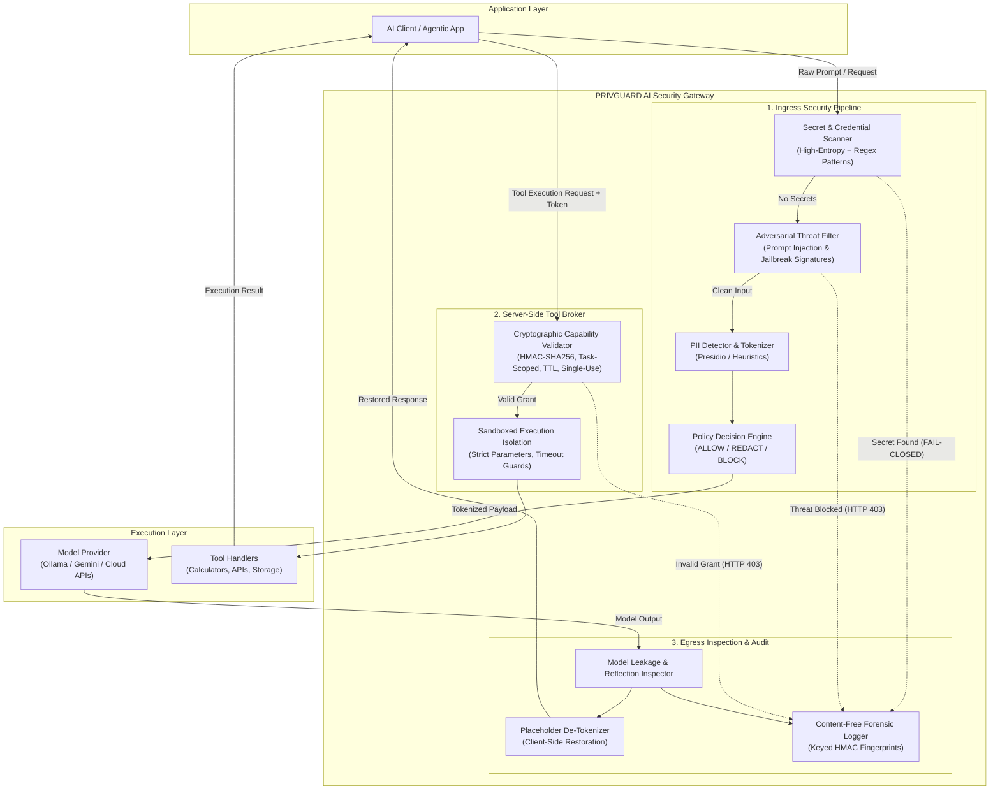
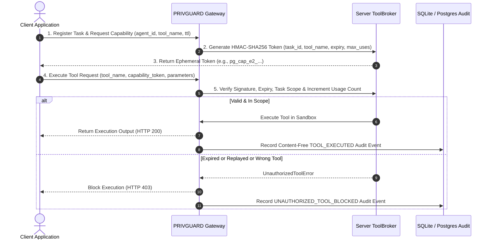

# PRIVGUARD AI — Technical Architecture & Enforcement Specifications

**Document Version:** 1.0 (Startup Buildathon India 2026)  
**System:** PRIVGUARD AI Security Gateway  
**Author:** Moon Sanctum Labs — *Decode. Build. Evolve.*  

---

## 1. System Overview & Core Philosophy

Modern generative AI applications suffer from an architectural anti-pattern: **security policies are evaluated inside the model context window**. This probabilistic approach leaves applications vulnerable to prompt injections, jailbreaks, data exfiltration, and unauthorized tool calls.

PRIVGUARD AI establishes an **independent, deterministic enforcement boundary** situated between the application code and external model/tool execution environments:

---

## 2. Ingress Request Lifecycle

### Step 1: Pre-Flight Secret & Credential Scanning
- **Engine:** `backend/app/privacy/secret_scanner.py`
- **Methodology:** Scans for high-entropy tokens, AWS access keys (`AKIA...`), OpenAI API keys (`sk-...`), GitHub personal access tokens, RSA private keys, and JWT signatures.
- **Enforcement:** If a critical secret is detected, the gateway immediately halts execution, logs a `SECRET_BLOCKED` audit record, and raises `SecretDetectedError` (HTTP 403) without transmitting data to the model.

### Step 2: Adversarial Threat & Prompt Injection Detection
- **Engine:** `backend/app/threat_detection/injection_detector.py`
- **Rule Set:** `rules/prompt_injection.py` (Rule `INJ_OVERRIDE_001`, `INJ_JAILBREAK_001`, Unicode zero-width character detection, Base64 payload decoding).
- **Enforcement:** Detects direct instruction overrides (e.g., *"Ignore all previous instructions"*), roleplay jailbreaks, and canary extraction attempts. Blocks with HTTP 403 `POLICY_VIOLATION` and persists content-free forensic alerts in `threat_events`.

### Step 3: Sensitive Data Detection & Tokenization
- **Engine:** `backend/app/privacy/pii_detector.py` & `backend/app/privacy/redactor.py`
- **Methodology:** Discovers email addresses, phone numbers, credit card numbers, SSNs, and names.
- **Tokenization:** Replaces raw values with indexed, type-safe placeholders (e.g., `sarah@cyberdyne.io` $\to$ `<EMAIL_1>`). Redaction mappings are preserved in memory strictly for the duration of the request.

---

## 3. Server-Side Tool Authorization & Sandboxing

LLMs are inherently probabilistic and cannot be trusted to self-authorize tool invocations. PRIVGUARD implements **Cryptographic Task-Scoped Capability Tokens**:

### Key Security Invariants:
1. **Zero Client Trust:** Tool invocations must present a valid cryptographic grant issued by PRIVGUARD.
2. **Single-Use or Monotonic Usage Bound:** Each capability token enforces `max_uses` (typically 1), preventing replay attacks.
3. **Task-Scoped Identity:** Capability tokens are bound to a specific `task_id` and `agent_id`; stolen tokens cannot be used across different agent contexts.

---

## 4. Egress Response Inspection & De-Tokenization

1. **Model Output Inspection (`backend/app/gateway/response_inspector.py`):**
   - Inspects generated text from upstream models for synthetic secret reflection or accidental credential leaks.
   - If a model outputs sensitive credentials, the response is blocked fail-closed with `RESPONSE_SECRET_BLOCKED`.
2. **Placeholder Restoration:**
   - Maps `<EMAIL_1>` and `<PHONE_NUMBER_1>` back to original values before returning the response to authorized clients.
   - Preserves downstream application functionality without ever revealing raw PII to the upstream model provider.

---

## 5. Content-Free Audit Logging

To comply with the EU AI Act, GDPR Article 30, and India DPDP Act 2023 without introducing new data leakage vectors, PRIVGUARD never logs raw prompt text.

- **Content Fingerprinting:** Every payload is hashed using a keyed HMAC-SHA256 algorithm:
  $$\text{Fingerprint} = \text{HMAC-SHA256}(K_{\text{audit}}, \text{Normalized Prompt})$$
- **Persisted Telemetry:**
  - Event Type (`PII_REDACTED`, `THREAT_BLOCKED`, `TOOL_EXECUTED`, `RESPONSE_DELIVERED`).
  - Risk Level (`LOW`, `MEDIUM`, `HIGH`, `CRITICAL`).
  - Entity Counts (e.g., `{"EMAIL": 1, "PHONE_NUMBER": 1}`).
  - Execution Latency (ms) and Security Action (`ALLOW`, `REDACT`, `BLOCK`).
- **Result:** Security teams can mathematically prove that an event occurred and verify data integrity during post-incident forensics without creating a secondary database of plain-text user communications.

