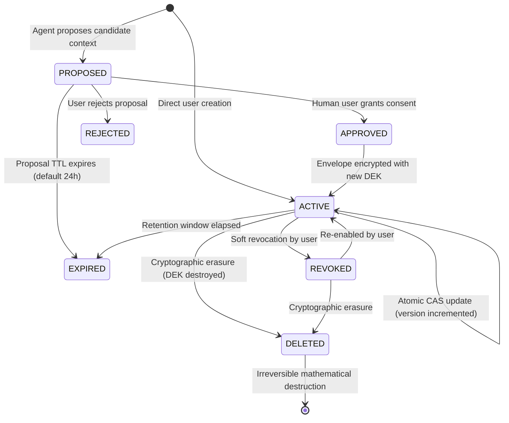

# PRIVGUARD AI — Memory Lifecycle & Concurrency Management

*Moon Sanctum Labs — Decode. Build. Evolve.*

## 1. Lifecycle State Machine

A memory record transitions through defined lifecycle states with strict cryptographic rules.



---

## 2. Memory Record States

| Status | Meaning | Cryptographic State | Retrievable? |
|---|---|---|---|
| `PROPOSED` | Candidate knowledge proposed by AI agent awaiting human review | Staged plaintext in proposal table (threat scanned) | No |
| `ACTIVE` | Authorized personal memory actively available for retrieval | Encrypted with AES-256-GCM envelope | Yes (if authorized) |
| `REVOKED` | User soft-disabled this memory without destroying data | Ciphertext preserved, status flag set to `REVOKED` | No |
| `EXPIRED` | Retention window elapsed | Ciphertext preserved until vacuum/purge | No |
| `DELETED` | Cryptographically wiped (right to be forgotten) | DEK replaced with `[DEK_DESTROYED]`, ciphertext replaced with `[CRYPTOGRAPHICALLY_ERASED]` | Never |
| `QUARANTINED`| Flagged for security anomaly or injection attempt | Ciphertext isolated, access blocked | No |

---

## 3. Provenance Tracking

Every stored memory item carries an immutable provenance indicator:

1. `USER_CONFIRMED`: Directly authored or explicitly confirmed by the human user.
2. `AI_PROPOSED`: Proposed by an autonomous AI agent and approved by user consent.
3. `EXTERNALLY_SOURCED`: Ingested from verified external documentation or user profiles.
4. `SYSTEM_GENERATED`: Generated by PRIVGUARD policy or environment configuration.

---

## 4. Optimistic Concurrency Control (CAS)

To prevent lost updates in multi-agent environments where multiple tasks might try to update the same memory item concurrently, PRIVGUARD enforces **Compare-And-Swap (CAS)**:

```python
# 1. Archive current encrypted version into MemoryVersion table
version_archive = MemoryVersion(
    memory_id=record.id,
    version_num=record.version,
    encrypted_content=record.encrypted_content,
    nonce=record.nonce,
    wrapped_dek=record.wrapped_dek,
    dek_nonce=record.dek_nonce,
    key_version=record.key_version,
    content_fingerprint=record.content_fingerprint,
    created_at=utcnow(),
)
db.add(version_archive)

# 2. Atomic CAS update
stmt_cas = (
    update(MemoryRecord)
    .where(
        MemoryRecord.id == memory_id,
        MemoryRecord.version == record.version, # Enforces that version hasn't changed
    )
    .values(
        encrypted_content=new_payload.ciphertext_b64,
        nonce=new_payload.nonce_b64,
        wrapped_dek=new_payload.wrapped_dek_b64,
        dek_nonce=new_payload.dek_nonce_b64,
        content_fingerprint=new_payload.content_fingerprint,
        version=record.version + 1,
        updated_at=utcnow(),
    )
)
```

If another process updated the record between reading and writing:
- `rowcount == 0`
- PRIVGUARD raises `409 Conflict` (`MEMORY_VERSION_CONFLICT`)
- The caller must reload the latest version and reconcile updates.
