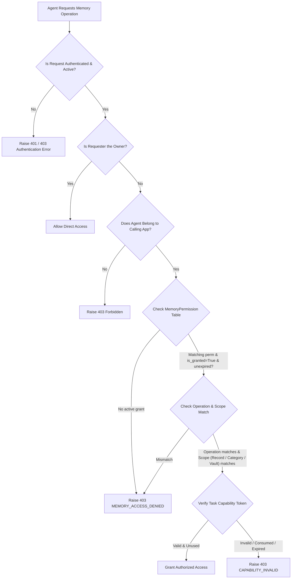

# PRIVGUARD AI — Memory Permissions & Authorization Model

*Moon Sanctum Labs — Decode. Build. Evolve.*

## 1. Default-Deny Security Model

In PRIVGUARD AI, autonomous agents operate in a zero-trust environment:
1. **Zero Access by Default:** Registering an agent gives it NO permissions to inspect, retrieve, or propose memories.
2. **Explicit Human Grant:** Permissions must be explicitly configured by the authenticated application owner.
3. **Task-Bound Capabilities:** In addition to active permissions, runtime retrievals require single-use capability tokens bound to the specific task execution.

---

## 2. Granular Operation Matrix

| Operation | Purpose | Scope Restrictions |
|---|---|---|
| `memory.read` | Allows agent to query and retrieve memories | Can be scoped to specific category or specific record ID |
| `memory.propose_write` | Allows agent to submit candidate memory proposals | Can be scoped to specific category |
| `memory.update` | Allows agent to propose/execute updates to existing memory | Requires record ID or category match |
| `memory.delete` | Allows agent to delete a specific memory item | Restricted to approved operational agents |

---

## 3. Allowed Memory Categories

To prevent arbitrary context contamination, memory items are strictly categorized into approved taxonomy:

1. `USER_PREFERENCES`: Display preferences, interaction style, language preference, coding habits.
2. `LEARNING_PREFERENCES`: Technical depth, explanation style, tutorial pacing.
3. `PROJECT_CONTEXT`: Non-sensitive architectural standards, project goals, tech stack conventions.
4. `WORK_CONTEXT`: Working hours, team guidelines, calendar availability boundaries.
5. `PERSONAL_PREFERENCES`: Tone of voice, communication formats, summary vs detail preferences.
6. `TASK_CONTEXT`: Ephemeral guidelines for active workflows.

Attempts to submit memory outside these approved categories raise `MemoryPoisoningError` (`400 Bad Request`).

---

## 4. Permission Evaluation Algorithm

When an agent requests an action on memory (e.g., retrieving `mem_abc` in category `USER_PREFERENCES` for `user_xyz`):

---

## 5. Multi-Tenant & Multi-User Isolation Invariants

- **Application Isolation:** Database queries strictly enforce `MemoryRecord.app_id == current_app.id`. Tenants cannot view, query, or affect each other's memories.
- **Owner Isolation:** Memory retrieval queries strictly filter `MemoryRecord.owner_id == owner_id`. Even with global read permissions within an app, Agent A servicing User X cannot retrieve records owned by User Y.
- **Audit Immutability:** Every permission check, grant, and revocation is recorded to `MemoryAuditEvent` with timestamp, agent ID, operation, and outcome.

