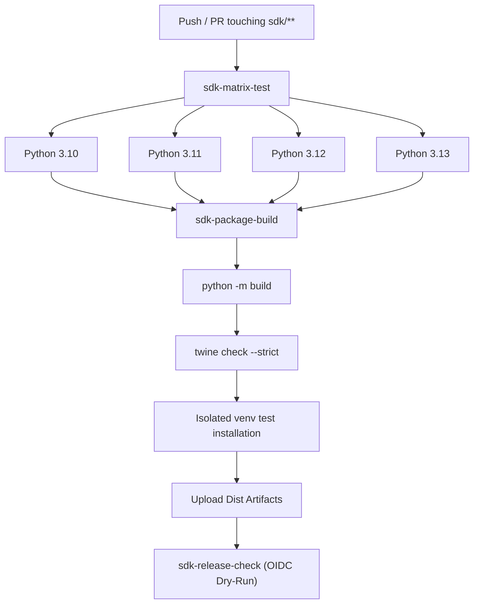

# PRIVGUARD AI — Python SDK Packaging & Release Governance

**Organization**: Moon Sanctum Labs  
**Motto**: Decode. Build. Evolve.  
**Package**: `privguard-sdk` (import: `privguard_sdk`)  
**Specification Version**: 1.0.0 (SDK Version: 0.1.0)  

---

## 1. Packaging Architecture (PEP 517 & PEP 621)

`privguard-sdk` conforms to modern Python Packaging Authority (PyPA) standards:

- **Build Backend**: `hatchling>=1.21.0` (configured in `pyproject.toml`).
- **Standard Metadata**: PEP 621 declarative tables for dependencies, classifiers, URLs, and optional extras (`[project.optional-dependencies]`).
- **Distribution Formats**:
  - Source Distribution (`sdist`): `privguard_sdk-<version>.tar.gz`
  - Pure Python Wheel (`bdist_wheel`): `privguard_sdk-<version>-py3-none-any.whl`
- **Typing Indicator**: PEP 561 marker file `src/privguard_sdk/py.typed` bundled directly in the root package directory.

---

## 2. Release & Versioning Policy

The SDK follows strict Semantic Versioning (SemVer 2.0.0):

- **Major (X.0.0)**: Breaking API changes (e.g. signature changes in resource methods, removal of deprecated attributes, or minimum Python version increases).
- **Minor (0.X.0)**: Backwards-compatible feature additions (e.g. new resource namespaces, additional Pydantic models, or new configuration flags).
- **Patch (0.0.X)**: Backwards-compatible bug fixes, security patches, or documentation improvements.

---

## 3. GitHub Actions CI/CD & PyPI Trusted Publishing

The SDK CI/CD pipeline is defined in `.github/workflows/sdk-ci.yml`:

### PyPI Trusted Publishing (OpenID Connect)

PRIVGUARD AI employs PyPI Trusted Publishing (OIDC) rather than long-lived API tokens:
1. GitHub Actions requests an OIDC token from GitHub's token authority.
2. The workflow exchanges the OIDC token with PyPI using `pypa/gh-action-pypi-publish@release/v1`.
3. PyPI validates the repository (`moonsanctum/privguard-ai`), workflow file, and cryptographic signature before accepting artifacts.
4. **Safety Control**: Automated publication only executes upon creation of an explicit SemVer git tag (`v*`) and manual workflow authorization. Public PyPI publication is blocked during development stages.

---

## 4. Pre-Release Quality Checklist

Before approving any public release of `privguard-sdk`:

1. [ ] **Changelog Updated**: Detailed entry in `sdk/python/CHANGELOG.md` covering all additions, fixes, and security patches.
2. [ ] **Version Bumped**: Consistent version strings in `pyproject.toml` and `src/privguard_sdk/__init__.py`.
3. [ ] **Test Coverage**: All SDK tests passing (`pytest sdk/python/tests/ -v`).
4. [ ] **Lint & Format**: Zero Ruff errors (`ruff check sdk/python` and `ruff format --check sdk/python`).
5. [ ] **Bandit Security**: Zero high or medium severity findings (`bandit -r sdk/python/src -ll -ii`).
6. [ ] **Clean Build**: Distribution packages built without warnings (`python -m build sdk/python`).
7. [ ] **Twine Verification**: Metadata passes strict inspection (`twine check --strict sdk/python/dist/*`).
8. [ ] **Isolation Test**: Wheel installs and imports successfully in a fresh virtualenv.
9. [ ] **Documentation**: API reference and usage examples updated and validated.

