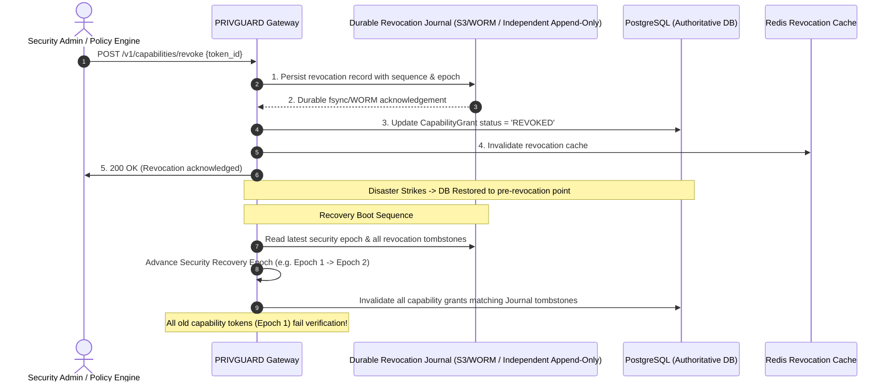
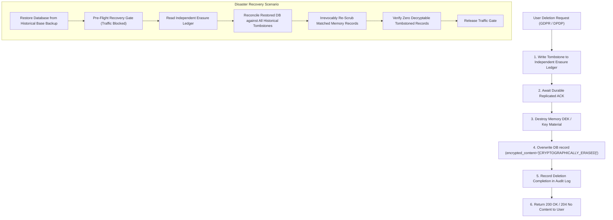

# PRIVGUARD AI — Stage 10.11 Architecture Correction Report

**Organization**: Moon Sanctum Labs  
**Motto**: Decode. Build. Evolve.  
**Lead Engineer**: Aniket Nandi (Kolkata, IST)  
**Milestone**: Stage 10.11 — Disaster Recovery & Production Validation  
**Status**: ARCHITECTURAL CORRECTION & DESIGN SPECIFICATION (NO IMPLEMENTATION STARTED)  
**Baseline Commit**: `16c0ed5`  
**Date**: November 8, 2026  

---

## 1. Executive Summary

Following the architecture review of the initial Stage 10.11 plan, this correction report formalizes the revised, production-grade disaster recovery architecture for PRIVGUARD AI. 

The two non-negotiable core invariants of PRIVGUARD AI are mathematically and operationally guaranteed under all disaster recovery scenarios:
1. **Zero-Revocation-Loss Invariant**: A revoked capability, suspended agent, or consumed approval can **never** become valid again because an older database snapshot or point-in-time recovery point was restored.
2. **Anti-Resurrection Privacy Invariant**: A deleted personal memory can **never** become recoverable or readable because an older database backup containing historical ciphertext was restored.

This report establishes the concrete technical design for independent revocation journals, security recovery epochs, append-only durable erasure ledgers, physical PostgreSQL PITR, isolated SQLite development tooling, category-specific Redis recovery semantics, production break-glass safeguards, and cryptographic backup signing.

**Confirmation**: As instructed, this is a planning and architecture document. No application source code has been modified, no database migrations have been generated, and no destructive recovery commands have been executed.

---

## 2. Revised Revocation Recovery Architecture & Security Epochs

### The Vulnerability with Database-Only PITR
In any point-in-time recovery (PITR) where PostgreSQL is restored to a timestamp $T_{\text{restore}}$ prior to a revocation event ($T_{\text{restore}} < T_{\text{revoke}}$), the restored database transactional state reflects the world before the revocation occurred. If the application relies solely on database state, the revoked capability is silently resurrected.

### The Solution: Epochs + Independent Revocation Journal



### Architecture Specifications:
1. **Durable Independent Revocation Journal**:
   - Resides outside the PostgreSQL database and its backup/restore stream.
   - Stored in a separately authenticated, append-only, replicated storage medium (e.g., Object Store with Object Lock / versioning, or independent append-only journal `var/recovery/revocation_journal.log` with cryptographic hash chaining).
   - Each entry records: `revocation_id`, `target_type` (`CAPABILITY`, `AGENT`, `APPROVAL`), `target_id`, `security_epoch`, `revoked_at`, `reason`, `signer_kid`, and `ed25519_signature`.
2. **Synchronous Commit Ordering**:
   - The API will never return `200 OK` for a revocation until the durable revocation journal has confirmed persistence.
3. **Monotonic Security Recovery Epoch (`security_epoch`)**:
   - A globally monotonically increasing integer counter representing the security generation of the deployment.
   - Every minted capability token includes `"sec_epoch": N` in its signed claims.
   - When a disaster recovery event occurs, the security operator or recovery script explicitly advances the epoch (`N -> N + 1`).
   - The token verification routine (`verify_capability_token()`) enforces `token.sec_epoch == current_system_epoch`. Any token minted under an earlier epoch is rejected immediately as `STALE_EPOCH_INVALIDATED`.
4. **Replay-Sensitive State & Pending Approvals**:
   - Pending Human-in-the-Loop (HITL) approvals from previous epochs are immediately transitioned to `EXPIRED_ON_RECOVERY`.
   - Replay tokens and action hashes from prior epochs are invalidated.
5. **Pre-Traffic Security Reconciliation Gate**:
   - During bootup after recovery, traffic is blocked at the proxy/middleware level until the recovery reconciliation runner completes replaying the independent revocation journal against the restored database.

---

## 3. Revised Memory Erasure Ledger & Cryptographic Anti-Resurrection

### The Resurrection Threat
A user requests erasure under GDPR Article 17 or India DPDP Section 12 at $T_1$. The memory record in the database is overwritten. Subsequently, a catastrophic hardware failure causes the operator to restore a PostgreSQL base backup taken at $T_0$ ($T_0 < T_1$). The restored backup contains the active ciphertext, IV, and wrapped DEK. Without an independent anti-resurrection control, the erased memory is resurrected.

### Independent Durable Erasure Ledger Design



### Architectural Specifications:
1. **Minimal Pseudonymous Tombstone Record**:
   To prevent the erasure ledger from becoming a secondary store of sensitive personal information, tombstones contain zero personal data:
   ```json
   {
     "tombstone_id": "tomb_01JA...",
     "memory_id": "mem_837261a9...",
     "tenant_id": "tenant_enterprise_01",
     "erasure_epoch": 3,
     "erased_at": "2026-11-08T14:30:00Z",
     "erasure_digest": "sha256:e3b0c44298fc1c149afbf4c8996fb92427ae41e4649b934ca495991b7852b855",
     "signature": "ed25519:5f8c..."
   }
   ```
2. **Transaction Ordering with Idempotent Retry**:
   1. Persist tombstone to independent, append-only, WORM/Object-Locked ledger.
   2. Verify durable write confirmation.
   3. Cryptographically destroy the DEK (or mark DEK metadata permanently destroyed in KMS).
   4. Update database record: `status = 'DELETED'`, `encrypted_content = '[CRYPTOGRAPHICALLY_ERASED]'`, `wrapped_dek = '[DEK_DESTROYED]'`, `nonce = '[WIPED]'`.
   5. Record deletion completion in the cryptographic audit ledger.
   6. Return success confirmation to client.
   - *Failure recovery*: If a crash occurs between step 2 and 4, the operation is retried idempotently; since the tombstone is already durable, reconciliation will enforce erasure even if the database update was interrupted.
3. **Recovery-Time Erasure Reconciliation**:
   - When the database is restored from a backup, the application does **not** accept memory read/write requests until the reconciliation runner completes.
   - The reconciliation runner compares the restored database records with the independent erasure ledger. Any record matching an erasure tombstone is immediately scrubbed in the restored database.
   - *Runtime Defense-in-Depth*: In `vault.retrieve_memory()`, the query joins or filters against the in-memory tombstone cache. Any access to a tombstoned memory ID fails closed with `404 Not Found`.

---

## 4. PostgreSQL and SQLite Recovery Separation

PostgreSQL and SQLite serve fundamentally different operational purposes in PRIVGUARD AI and must have completely distinct backup and recovery procedures.

```
                      DATABASE RECOVERY ARCHITECTURE
                                     │
           ┌─────────────────────────┴─────────────────────────┐
           ▼                                                   ▼
┌─────────────────────────────────┐         ┌─────────────────────────────────┐
│       PRODUCTION & STAGING      │         │     LOCAL DEV & UNIT TESTS      │
│       PostgreSQL 16 Engine      │         │          SQLite WAL             │
├─────────────────────────────────┤         ├─────────────────────────────────┤
│ • Physical Base Backups         │         │ • Atomic SQLite online backup   │
│ • Continuous PostgreSQL WAL     │         │ • PRAGMA wal_checkpoint(TRUNCATE│
│   Archiving (pg_wal)            │         │ • Local file copy (.db -> .bak) │
│ • Point-in-Time Recovery (PITR) │         │ • Fast developer reset          │
│ • Signed Manifest (Ed25519)     │         │ • No PITR or WAL shipping       │
│ • AES-256-GCM Backup Encryption │         │ • Separate test runner scripts  │
│ • Restricted Role RLS Check     │         │                                 │
└─────────────────────────────────┘         └─────────────────────────────────┘
```

### 4.1 PostgreSQL Point-in-Time Recovery (PITR)
- **Base Backup**: Created via PostgreSQL streaming replication protocol (`pg_basebackup`) or transaction-consistent physical snapshot.
- **Continuous WAL Archiving**:
  - PostgreSQL `archive_command` continuously ships completed 16MB WAL segments from `pg_wal` to segregated backup storage.
  - WAL continuity is strictly validated: no missing segment numbers in the WAL timeline.
- **Recovery Targets**:
  - `recovery_target_time`: Specific timestamp before failure or corruption.
  - `recovery_target_lsn`: Exact Log Sequence Number.
  - `recovery_target_name`: Named restore point.
- **Backup Manifest & Cryptographic Signing**:
  - Each base backup and WAL set is cataloged in `manifest.json`.
  - Manifest is cryptographically signed using a dedicated `KeyPurpose.BACKUP_SIGNING` Ed25519 private key.
- **Verification on Restored Instance**:
  - Must run with restricted non-superuser role (`privguard_app`) to verify that PostgreSQL Row-Level Security (`FORCE ROW LEVEL SECURITY`) remains active and unbypassed after restore.

### 4.2 SQLite Development / Testing Backup
- Implemented in `scripts/recovery/backup_sqlite_dev.py` and `scripts/recovery/restore_sqlite_dev.py`.
- Uses Python `sqlite3` connection backup API (`con.backup(dest_con)`).
- Does not use or reference PostgreSQL WAL commands.

---

## 5. Redis State Recovery Matrix & Semantics

Redis data is partitioned into distinct semantic classes with tailored recovery behaviors:

| Redis State Namespace | Key Pattern | Loss Impact | Authoritative Source | Recovery & Reconciliation Protocol |
| :--- | :--- | :--- | :--- | :--- |
| **Revocation Cache** | `revocations:{tenant}:{id}` | Critical: Revocation bypass | PostgreSQL + Revocation Journal | **Fail-Closed**: Rebuild cache from PostgreSQL and durable journal before opening traffic. Unverified tokens rejected. |
| **Active Taint State** | `taint:{tenant}:{agent_id}` | Critical: Exfiltration bypass | PostgreSQL `ActiveTaint` | **Reconstruct**: Query PostgreSQL `ActiveTaint` and repopulate Redis. If state cannot be verified, taint fails closed to `TAINTED`. |
| **Policy Synchronization**| `policy:{tenant}:bundle` | Critical: Policy downgrade | PostgreSQL `PolicyBundle` | **Verify & Reload**: Fetch latest Ed25519-signed policy bundle from PostgreSQL. Reject stale or unsigned bundles. |
| **Event Streams** | `stream:events` | High: Event delivery loss | PostgreSQL `OutboxEvent` | **Replay**: Outbox worker resumes from last acknowledged event sequence, republishes unacknowledged events with consumer deduplication. |
| **Rate Limit Counters** | `rl:{tenant}:{identifier}` | Medium: Short abuse window | Redis (Ephemeral) | **Safe Restriction Mode**: On cold restart, apply strict defensive rate limits for 10 minutes to protect downstream LLMs during warmup. |
| **General Response Cache** | `cache:{hash}` | Low: Cache misses | Upstream Provider / None | **Clean Start**: Cache is safely purged; repopulates on demand. |

---

## 6. Production Recovery Boundaries & Break-Glass Governance

Automated command-line recovery scripts are strictly restricted:
- **Allowed Automated Environments**: `development`, `test`, `staging`.
- **Prohibited Automated Target**: `production`.

### Production Break-Glass Recovery Procedure
Production restoration cannot be executed via an automated CLI script with a simple prompt confirmation. It requires an operator-controlled, multi-step runbook:
1. **Incident Declaration & Dual Authorization**:
   - Two designated operators (e.g. Lead SRE + Security Officer) must authenticate and authorize the recovery procedure.
2. **Environment Isolation**:
   - Cut off ingress traffic at the edge reverse proxy (Caddy / Ingress Controller returning `503 Maintenance`).
3. **Backup Provenance Verification**:
   - Verify backup archive checksums and Ed25519 digital signature against the organization's offline trusted public key.
4. **Staging Dry-Run**:
   - Execute restore on an isolated staging clone first to verify schema migrations and data integrity.
5. **PostgreSQL Physical Restore & WAL Replay**:
   - Restore base backup and replay continuous WAL up to selected recovery target.
6. **Execute Anti-Resurrection & Revocation Reconciliation**:
   - Replay independent erasure ledger and revocation journal.
   - Advance security recovery epoch (`security_epoch += 1`).
7. **Restricted RLS & Health Verification**:
   - Validate tenant isolation with `privguard_app` non-superuser role.
   - Execute SDK smoke tests.
8. **Traffic Enablement**:
   - Release ingress traffic.

---

## 7. Cryptographic Key Custody, KMS & Backup Signing

### 7.1 Dedicated Key Purpose: `KeyPurpose.BACKUP_SIGNING`
- In Stage 10.5, we established key separation for `POLICY_SIGNING` and `EVIDENCE_SIGNING`.
- Stage 10.11 adds `KeyPurpose.BACKUP_SIGNING`:
  - Ed25519 private key used solely for signing backup manifests (`manifest.json`).
  - Public key distributed via trusted operator configuration or PKI.

### 7.2 Multi-Region KMS & Key Recovery
- PRIVGUARD AI never exports plaintext root KEKs into backup archives.
- **AWS KMS**: Utilizes multi-region replica keys (`arn:aws:kms:region:account:key/...`) synchronized across primary and disaster recovery regions.
- **GCP Cloud KMS**: Utilizes multi-region key rings (`us-locations` / `europe-locations`).
- **Local/Mock KMS**: Explicitly documented as `NOT_LIVE_VERIFIED` for development only.

---

## 8. Measurable RPO / RTO & Observability Metrics

All recovery targets remain explicitly designated as `PENDING_OWNER_APPROVAL`:

| Component | Target RPO | Target RTO | Measurement Metric |
| :--- | :--- | :--- | :--- |
| **PostgreSQL Database** | $\le$ 5 minutes | $\le$ 30 minutes | `privguard_dr_wal_archive_lag_seconds` |
| **Capability Revocations**| 0 seconds (RPO = 0) | $\le$ 2 minutes | `privguard_dr_revocation_reconcile_duration_seconds` |
| **Memory Erasure** | 0 seconds (RPO = 0) | $\le$ 5 minutes | `privguard_dr_erasure_reconcile_duration_seconds` |
| **Redis Cache / State** | Ephemeral / Rebuilt | $\le$ 5 minutes | `privguard_dr_redis_sync_duration_seconds` |
| **KMS Provider** | 0 seconds (Immutable)| $\le$ 15 minutes | `privguard_dr_kms_latency_seconds` |
| **Full Application** | $\le$ 5 minutes | $\le$ 45 minutes | `privguard_dr_drill_total_duration_seconds` |

### Prometheus Alerting Rules:
- `PrivguardWalArchiveLagHigh`: Alert when WAL archive lag exceeds 5 minutes (critical threat to 5-minute RPO).
- `PrivguardBaseBackupStale`: Alert when last verified physical base backup is older than 24 hours.
- `PrivguardRecoveryDrillFailed`: Alert on any failed automated recovery drill.
- `PrivguardErasureReconciliationFailure`: Critical page if tombstone reconciliation fails during boot.

---

## 9. Stage 10.10 Carry-Over Resolutions

1. **Python Compatibility**:
   - `sdk/python/pyproject.toml` updated to `requires-python = ">=3.11"`.
   - Classifiers: Python 3.11, 3.12, 3.13, 3.14. Python 3.15 explicitly noted as unsupported until official release and ecosystem validation.
   - `.github/workflows/sdk-ci.yml` matrix updated to `["3.11", "3.12", "3.13", "3.14"]`.
2. **Performance Benchmark Methodology**:
   - `backend/tests/test_performance_stage_3.py`: Strict thresholds (`hash_p95 < 1.0 ms`, `cap_p95 < 250.0 ms`, `exec_p95 < 400.0 ms`) restored.
   - Warm-up loop and explicit garbage collection / connection pool reset added before timing measurement to eliminate full-suite SQLite disk I/O interference.
3. **SDK Offline Verifier Security Hardening**:
   - Identity trust decoupled from mathematical signature validity: embedded keys cannot yield `trust_verified=True`.
   - Comprehensive test suite for path traversal (`../`), unmanifested files, duplicate files, and decompression bombs added to `sdk/python/tests/verification/test_verification.py`.

---

## 10. Remaining External Dependencies & Unresolved Assumptions

1. **Live Cloud KMS & Multi-Region Storage**:
   - Automated test execution in CI/CD and local environments utilizes local mock providers and isolated file stores. Live cloud KMS failover (AWS/GCP) requires cloud credentials and is designated `NOT_LIVE_VERIFIED` in local drills.
2. **WORM / Object Lock Storage**:
   - Production deployment requires an S3-compatible or GCS bucket configured with Object Lock (Compliance mode) for the independent erasure and revocation ledgers. Local drill environments simulate this via append-only, read-only file permissions.
3. **Owner Approval of RPO / RTO**:
   - The RPO / RTO targets remain marked `PENDING_OWNER_APPROVAL`.

---

**Architectural Signoff**:  
Aniket Nandi, Lead Full-Stack Developer & Designer  
Moon Sanctum Labs — *Decode. Build. Evolve.*

